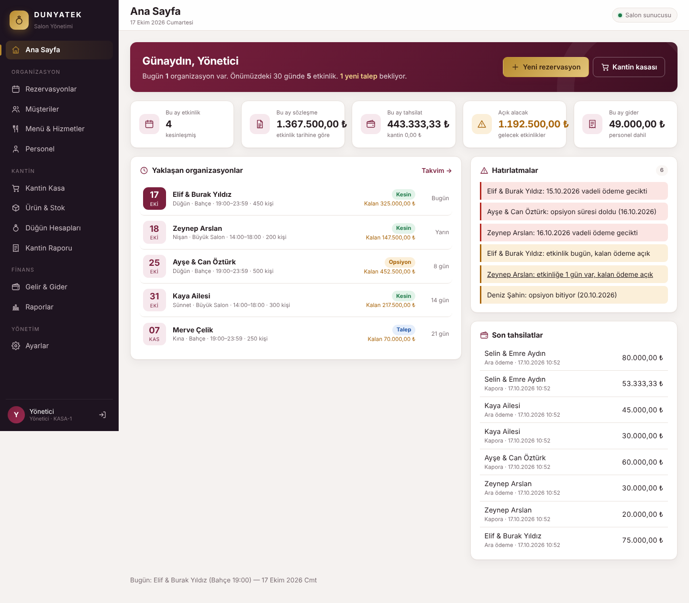

# DUNYATEK Wedding ERP

Düğün salonu için **barkodlu kantin satışı**, **stok takibi**, **düğün (organizasyon) hesapları** ve **rezervasyon** yazılımı.
Önce-çevrimdışı (offline-first) hibrit mimari: salondaki Windows mini PC ana işlem merkezidir, internet kesilse de
salon ağı (LAN) üzerinden çalışmaya devam eder. Bulut (Cloudflare Workers + D1, `dunyasalon.com`) uzaktan izleme,
merkezi rapor ve rezervasyon talebi içindir.

```
Cloudflare (dunyasalon.com)                    Salon mini PC (Windows)
┌─────────────────────────────┐   HTTPS        ┌──────────────────────────────────┐
│ Hono Worker + Static Assets │◀──push/pull───▶│ Node.js + Hono yerel API         │
│ D1: olay günlüğü + raporlar │   (outbox)     │ SQLite (WAL) · yetkili kaynak    │
└─────────────────────────────┘                │ Sync motoru · yedekleme          │
                                               └───────────────┬──────────────────┘
                                                      LAN      │ http://192.168.1.50:8787
                                         Kantin kasaları · Resepsiyon · Yönetici
```

## Klasör yapısı

```
apps/
  web/            Vanilla JS + CSS SPA (Vite) — kasa, stok, rezervasyon, hesaplar, özet, bulut paneli
  local-server/   Hono + node:sqlite — salonun yerel API'si, senkron motoru, yedekleme
  cloud-worker/   Hono + Cloudflare D1 — /api/sync/push|pull, uzaktan panel API'si
packages/
  shared/         Ortak tipler, kuruş/miktar yardımcıları, UUIDv7, doğrulama
  business-rules/ Satış toplamları, ödeme doğrulama, rezervasyon çakışma kuralları
  sync-protocol/  Senkron olay tipleri ve protokol
migrations/
  local/          Mini PC SQLite şeması
  cloud/          D1 şeması
scripts/          install-windows.ps1 · backup.ps1 · restore.ps1 · health-check.ps1
tests/            pos · reservations · synchronization (kabul testleri)
```

## Neler hazır (v0.2)



**Salon yönetimi (v0.2, salon-takip.com karşılaştırmasıyla eklendi)**
- **Ana sayfa**: bugünkü ve 30 günlük organizasyonlar, aylık sözleşme / tahsilat / gider / açık alacak kartları, otomatik hatırlatmalar (opsiyon bitişi, geciken vade, bakiye açık, davetli sayısı eksik, kapatılmamış etkinlik), son tahsilatlar
- **Rezervasyon ayrıntısı**: salon ücreti + menü/hizmet kalemleri − indirim = toplam; tahsil edilen, kalan, geciken; opsiyon bitiş tarihi
  - Menü & hizmet kalemleri (sabit veya kişi başı; kişi başında adet davetli sayısından gelir)
  - Tahsilatlar: kapora / ara ödeme / kalan / iade, nakit-kart-havale, sıra numaralı **makbuz yazdırma**, gerekçeli iptal
  - Ödeme planı (taksitler, otomatik plan, gecikenler kırmızı), personel ataması, görüşme notları, gider ve organizasyon kârlılığı
  - **Sözleşme yazdırma** (A4: taraflar, etkinlik, kalemler, ödeme planı, maddeler, imza alanları)
  - **WhatsApp / SMS mesajı**: düzenlenebilir şablonlarla (onay, opsiyon, ödeme, etkinlik hatırlatma, makbuz) tek tıkla
- **Müşteri kartı**: tüm organizasyonları, toplam/ödenen/kalan, adres ve T.C. kimlik no, notlar, gönderilen mesajlar
- **Menü & hizmetler**: paket, menü ve ek hizmet tanımları
- **Personel**: görev, yevmiye, etkinlik programı, aylık hakediş
- **Gelir & gider**: dönem özeti (rezervasyon tahsilatı + kantin + diğer gelir − gider − personel), kategori dağılımı
- **Raporlar**: yıllık aylık gelir/gider grafiği, etkinlik sayısı, haftanın günleri, etkinlik türü ve salon kırılımı
- **Ayarlar**: işletme bilgileri, sözleşme maddeleri, mesaj şablonları, kullanıcı ekleme/rol/şifre/pasifleştirme, salonlar
- Yeni tablolar da buluta eşitlenir (`row.upserted` olayı)

**Kantin POS**
- Barkod okuyucu ile satış (okuyucu klavye gibi çalışır; `3*barkod` = 3 adet), ürün adıyla arama, kategori kutucukları
- Nakit (para üstü hesabı), kart ve **düğün hesabına yazma**; kısayollar F2 / F3 / F4, Esc
- Satış + kalemler + ödemeler + stok hareketi + düğün hesabı borcu + senkron olayı **tek SQLite transaction'ında**
- İstemci her sepete kimlik verir: bağlantı kopup aynı satış tekrar gönderilirse **çift satış oluşmaz**
- Stok sıfırın altına düşemez: **son ürünü iki kasa aynı anda satamaz**
- İade (stok geri alınır, düğün hesabına alacak düşer), kasa oturumu aç/kapat ve nakit farkı
- Fiyat her zaman sunucudaki ürün kartından alınır (istemciden gelen fiyata güvenilmez)

**Stok**: ürün kartı (barkod, kategori, KDV, birim), giriş / sayım / fire hareketleri, olay bazlı stok geçmişi, azalan stok listesi.

**Düğün yönetimi**
- Salonlar, aylık takvim, rezervasyon durumları: talep → opsiyon → kesin → tamamlandı / iptal
- Çakışma kontrolü mini PC'de, yazma kilidi altında; gece yarısını geçen etkinlikler ve etkinlikler arası temizlik payı (varsayılan 60 dk) hesaba katılır
- "Talep" takvimi kilitlemez; "opsiyon" ve "kesin" kilitler
- Eşzamanlı düzenlemeye karşı sürüm kontrolü (iyimser kilit)
- Kesinleşen her rezervasyona otomatik **düğün hesabı**; hesapta borç/tahsilat, limit, kapatma, yazdırma

**Senkronizasyon**
- Her iş kaydı aynı transaction içinde `sync_outbox`'a olay olarak yazılır; internet yoksa olaylar kuyrukta bekler
- Bağlantı gelince sırayla `/api/sync/push`; bulut `event_id` ile tekilleştirir ve olayı + projeksiyonları **tek D1 `batch()`** ile atomik yazar
- Bulutta stok bakiyesi kopyalanmaz, hareketlerden türetilir
- Uzaktan (dunyasalon.com) yalnızca **rezervasyon talebi** alınır; `/api/sync/pull` ile salona "talep" olarak düşer, kesinleştirme resepsiyonda yapılır
- Üstel geri çekilmeyle tekrar deneme, durum ekranı (bekleyen / hatalı / son eşitleme)

**Diğer**: kullanıcılar ve roller (admin, kasiyer, resepsiyon, muhasebe), oturum belirteçleri (scrypt şifre), denetim kaydı (`audit_logs`), günlük özet raporu, tutarlı çevrimiçi yedekleme + bütünlük kontrolü.

Tüm tutarlar **tamsayı kuruş**, miktarlar **×1000 ölçekli tamsayı** olarak tutulur.

## Geliştirme

Gereksinim: Node.js 24 LTS (en az 22.16). Ek bir yerel derleme gerekmez; SQLite için Node'un yerleşik `node:sqlite` modülü kullanılır.

```bash
npm install
ADMIN_PASSWORD=admin123 npm run seed -w @dunyatek/local-server -- --demo   # yönetici + örnek salon/ürünler
npm run dev:local     # yerel API  → http://localhost:8787
npm run dev:web       # arayüz     → http://localhost:5173 (/api yerel sunucuya yönlenir)
npm test              # kabul testleri
npm run typecheck
```

Bulut tarafını yerelde denemek için:

```bash
cd apps/cloud-worker
printf 'SYNC_TOKEN=dev-sync\nADMIN_TOKEN=dev-admin\n' > .dev.vars
npm run db:migrate:local
npm run build -w @dunyatek/web && npx wrangler dev --port 8788
# yerel sunucuyu CLOUD_URL=http://localhost:8788 CLOUD_TOKEN=dev-sync ile başlatın
```

## Salon mini PC kurulumu (Windows 11 Pro)

Önerilen başlangıç: Intel N100 veya üzeri, 16 GB RAM, 256 GB SSD, kablolu Ethernet, **UPS**.

1. Node.js 24 LTS ve Git'i kurun, depoyu indirin.
2. Yönetici PowerShell'de, depo klasöründen:
   ```powershell
   powershell -ExecutionPolicy Bypass -File .\scripts\install-windows.ps1 `
     -AdminPassword "GucluBirSifre" -CloudUrl "https://dunyasalon.com" -CloudToken "<SYNC_TOKEN>"
   ```
   Betik `C:\DUNYATEK\WeddingERP\{app,data,backups,logs,config}` klasörlerini kurar, uygulamayı derler,
   yönetici kullanıcıyı oluşturur ve şunları kaydeder:
   - **Sunucu görevi**: Windows açılışında, oturum açılmadan SYSTEM olarak başlar, çökünce 1 dk içinde yeniden başlar
   - **Günlük yedek** (04:00, son 30 yedek; `-CopyTo` ile USB/NAS kopyası)
   - **Sağlık kontrolü** (5 dakikada bir; API yanıt vermezse yeniden başlatır, disk ve kuyruk uyarıları)
   - Güvenlik duvarı: port yalnızca yerel alt ağa açık
3. Mini PC'ye modemden sabit IP verin (ör. `192.168.1.50`), ağ profilini "Özel" yapın.
4. Kasa ve resepsiyon bilgisayarlarında `http://192.168.1.50:8787` adresini masaüstü kısayolu olarak açın
   (giriş ekranında her kasaya ayrı terminal adı verin: KASA-1, KASA-2...).

Geri yükleme: `scripts\restore.ps1 -BackupFile C:\DUNYATEK\WeddingERP\backups\wedding-....db`

SQLite dosyası ağ paylaşımına konmaz; diğer bilgisayarlar veritabanına değil, yalnızca API'ye bağlanır.

## Cloudflare kurulumu (dunyasalon.com)

```bash
cd apps/cloud-worker
npx wrangler login
npx wrangler d1 create dunyasalon-db          # çıktıdaki database_id'yi wrangler.jsonc'a yazın
npm run db:migrate:remote
npx wrangler secret put SYNC_TOKEN            # mini PC'deki CLOUD_TOKEN ile aynı, uzun rastgele değer
npx wrangler secret put ADMIN_TOKEN           # uzaktan panel anahtarı
npm run deploy                                # web arayüzünü derler ve Worker'ı yayınlar
```

`dunyasalon.com` bulut panelinde yönetim anahtarıyla giriş yapılır. Gerçek kullanımda paneli ayrıca
**Cloudflare Access** (e-posta ile tek kullanımlık kod) arkasına almanızı öneririm.

## Kabul testleri

`npm test` şu senaryoları otomatik doğrular (bulut tarafı gerçek Worker kodu + D1 şemasıyla çalışır):

| Senaryo | Test |
|---|---|
| Kesinti sırasında 100 satış, hiçbiri kaybolmaz | `pos`, `synchronization` |
| İnternet gelince 100 satış buluta birer kez işlenir | `synchronization` |
| Aynı satış/olay iki kez gönderilir, çift stok düşümü olmaz | `pos`, `synchronization` |
| İki kasadan son ürünü satma, yalnızca biri başarılı | `pos` |
| Aynı salon ve saate iki rezervasyon engellenir | `reservations` |
| Hatalı ödemede hiçbir kayıt yazılmaz (atomiklik) | `pos` |
| Düğün hesabına yazma, iade ve limit | `pos` |
| Uzaktan talep salona "talep" olarak düşer, tekrar işlenmez | `synchronization` |
| Yanlış senkron anahtarı reddedilir | `synchronization` |

Mini PC yeniden başlatma, 30 dk gerçek internet kesintisi ve yedekten geri yükleme testleri salondaki
cihazda elle yapılmalıdır (betikler hazır).

## Canlıya geçmeden önce yapılacaklar

- **Mali belge**: e-Arşiv / ÖKC (yazar kasa) entegrasyonu — şu an satış fişi mali belge değildir
- **Kart ödemesi**: POS cihazı entegrasyonu (şimdilik kasiyer "Kart" seçer, tutar cihazdan ayrıca çekilir)
- **Yerel HTTPS** (`salon.local.dunyasalon.com` için yerel DNS + sertifika)
- Ürün içe aktarma (Excel), fiş yazıcısı
- Otomatik SMS gönderimi için SMS firması entegrasyonu (şimdilik WhatsApp/SMS bağlantısı)
- KVKK: müşteri verisi saklama süresi, aydınlatma metni, erişim kayıtlarının gözden geçirilmesi
